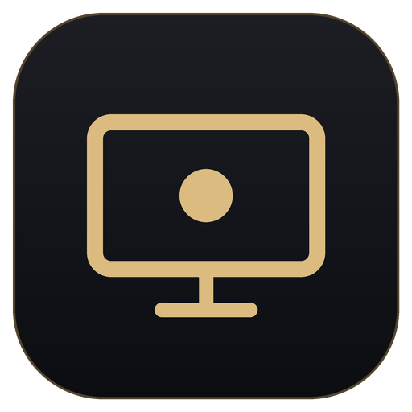

# Amos錄影與截圖

**v1.3.2 · Windows 10 2004 以上／Windows 11 · x64**

[下載 Windows 安裝精靈](https://github.com/stu310101-arch/screen_recoder/releases/latest/download/AmosRecorder-Setup.exe) · [版本說明](../../releases/latest) · [完整使用說明](使用說明.md)

支援螢幕、範圍、指定視窗錄影與截圖，浮動控制列、暫停繼續、系統聲音與麥克風。採用 Amos 統一黑金圖示。

1. 下載並執行 `AmosRecorder-Setup.exe`。
2. 依安裝精靈完成安裝，保留預設勾選的「建立桌面捷徑」。
3. 從桌面或開始功能表開啟「Amos錄影與截圖」。

程式包含 .NET 執行環境。安裝於目前使用者的 `%LOCALAPPDATA%\Programs\AureoRecorder`。解除安裝保留錄影、圖片與設定。既有使用者的儲存位置保留；新使用者預設使用影片／圖片資料夾內的「Amos錄影與截圖」資料夾。

`Source` 包含 WPF 原始碼；`installer` 包含 Inno Setup 安裝腳本。依 [使用說明](使用說明.md) 操作與檢視限制。

## Amos 工具系列

| 工具 | 功能 | Windows 安裝精靈 |
| --- | --- | --- |
| Amos錄影與截圖 | 螢幕錄影、範圍與視窗截圖 | [下載](https://github.com/stu310101-arch/screen_recoder/releases/latest/download/AmosRecorder-Setup.exe) |
| Amos影音下載 | 影音下載、合併與轉檔 | [下載](https://github.com/stu310101-arch/AUREATE/releases/latest/download/AmosDownloader-Setup.exe) |
| Amos電腦手機連結器 | 電腦與手機互傳檔案、文字 | [下載](https://github.com/stu310101-arch/aureo-link/releases/latest/download/AmosLink-Setup.exe) |

三款採用統一黑金圖示。下載後執行安裝精靈，預設勾選建立桌面捷徑，也會加入開始功能表與 Windows 解除安裝清單。

圖示修正：桌面與開始功能表捷徑直接使用已安裝、帶版本號的獨立黑金 ICO，避免沿用舊版 EXE 圖示快取。請執行最新版安裝精靈並保留「建立桌面捷徑」勾選。
